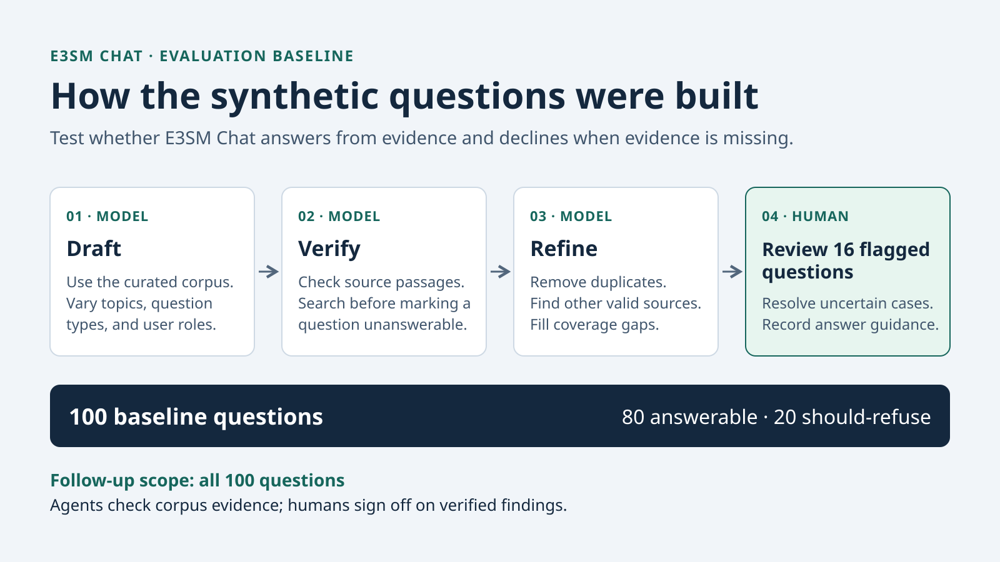

# Synthetic evaluation questions

This document explains how the synthetic questions were designed and
generated, and what the initial human review covered. It also points to the
follow-up review of all 100 questions against the corpus.

[`corpus/questions.json`](../../corpus/questions.json) contains 100 synthetic
questions based on the curated corpus for #37. They set a [baseline for
E3SM Chat](3-scoring.md):

- **80 answerable:** Can it find and use supporting evidence?
- **20 should-refuse:** Does it decline when the corpus lacks enough evidence?

## Question design

The questions adapt Hamel Husain's
[test-data framework](https://hamel.dev/blog/posts/field-guide/#a-framework-for-generating-realistic-test-data).
Varying the topic, the kind of question, and who asks it keeps the baseline
from reflecting only straightforward lookups:

- **Feature:** running cases (CIME, running-E3SM guide, machine and batch
  XML); model components (EAM, EAMxx, ELM, MOSART, MPAS-Ocean, MPAS-Seaice,
  data ocean); diagnostics (e3sm_diags, zppy, MPAS-Analysis); analysis tools
  (NCO, xCDAT); environment and tooling (E3SM-Unified, mache, zstash,
  e3sm_to_cmip, MPAS-Tools, feedstock recipes); data access (E3SM Data Docs).
- **Scenario:** answer in one document; answer across documents or projects;
  depends on a version; troubleshooting; vague or loosely worded; should
  refuse (out of scope, or in domain but undocumented, including near misses).
- **Persona:** new user on a first run, analyst running diagnostics, model
  developer, researcher reproducing or using published simulations. Wording
  ranges from jargon to plain, lowercase fragments.

Near-miss pairs are deliberate: the corpus supports an answer on one topic
but not on a closely related one. For example, it gives a citation for v3.LR
but not for v3.RRM. These pairs test whether E3SM Chat can distinguish evidence
that answers the question from evidence that only looks relevant.

## Process

### How the questions were built

The model worked directly from `corpus/local/corpus-expanded`, a local build
with 539 documents matching the scope in `corpus/sources.json`. It used
neither the application's retrieval nor the web.

1. **Draft.** The model started with single-document how-tos, then varied
   topics, question types, and user roles to go beyond straightforward lookups.
2. **Verify and select.** The model read supporting passages for answers and
   checked the closest search hits for refusals. It selected questions so no
   one area dominated the set.
3. **Refine.** The model reduced overlap, filled gaps, and looked for other
   valid sources so scoring would not penalize finding a different source.
4. **Fill document coverage.** The model brought the set to 100 questions and
   made sure every explicit content document in `corpus/sources.json` appeared
   in at least one question’s `expected_documents`.
5. **Review flagged questions.** A person resolved all 16 flags, clarifying
   expected sources, refusal decisions, and what good answers should say.

#### Build notes

- **Drafting:** 168 drafts, minus 18 near-duplicates, left 125 answerable and
  25 should-refuse candidates. In all, the model considered 169 candidates.
- **Round 1:** Selected 64 answerable and 18 should-refuse questions.
- **Round 2:** Added six expected documents across five questions, removed one
  expected document, reworded one question, and replaced four questions
  (three with new candidates).
- **Round 3:** Reworded one question and added five review flags.
- **Document coverage:** Added 16 answerable questions and two refusals,
  added one expected document, and reworded one question.
- **Initial human review:** Added expected documents to two questions,
  reworded one question, kept three near-miss refusals, and recorded answer
  guidance for 16 questions. Identified two corpus gaps and two upstream
  issues ([e3sm_diags#1109](https://github.com/E3SM-Project/e3sm_diags/issues/1109),
  [e3sm-unified#159](https://github.com/E3SM-Project/e3sm-unified/issues/159)).

### Why this approach

- **Compare changes consistently.** Use a repeatable baseline for E3SM Chat.
- **Test for missed evidence.** Start from curated source text, not the
  app’s search results.
- **Cover a range of questions.** Use the model to draft across topics,
  question types, and user roles.
- **Ground the labels.** Check source passages for expected documents and
  have a person resolve the cases the model flagged as uncertain.

### Trade-offs and limitations

- **Coverage is not representativeness.** The questions were generated from
  the corpus, not collected from users. The mix tests a range of cases and
  covers every explicitly selected document, but it does not show how often
  real users ask these questions or use this wording.
  - **How to address it:** Use [expert-written questions (#38)](https://github.com/E3SM-Project/e3sm-ai-platform/issues/38)
    to improve realism. Use real user questions, when available, to check
    what users actually ask.
- **Verification was not independent.** The model wrote the questions, chose
  the expected documents, and assigned the tags. The initial human review
  covered only the 16 flagged questions; it could not catch errors in the
  other 84.
  - **How to address it:** The [follow-up review](2-agent-assisted-human-review.md)
    records human sign-off on the agent’s findings for all 100 questions.
- **Search can miss evidence.** A read passage supports an expected document,
  but keyword searches can miss other valid sources or partial answers that
  use different wording. A refusal reflects what was found in the snapshot,
  not proof that no answer exists.
  - **How to address it:** For refusals and ambiguous cases, search with
    synonyms, acronyms, and version names, then read likely source sections.
    In [#37 error analysis](https://github.com/E3SM-Project/e3sm-ai-platform/issues/37),
    distinguish a corpus gap from a missing expected source or a retrieval miss.
- **Evidence can go stale.** Release snapshots may not reflect current
  facility settings, paths, or E3SM-Unified package pins.
  - **How to address it:** Refresh sources in [versioned corpus releases (#31)](https://github.com/E3SM-Project/e3sm-ai-platform/issues/31)
    and recheck affected questions against the new snapshot before changing
    scoring fields.

## Final coverage

The table summarizes the final question set in
[`corpus/questions.json`](../../corpus/questions.json). See the
[question file format](../../corpus/README.md#question-file-format) for field
definitions and allowed values.

**Scenario legend**

- **Single:** One document answers the question.
- **Multi:** The answer draws on multiple documents.
- **Version:** The answer depends on a specific version.
- **Trouble:** The question asks how to diagnose or fix a problem.
- **Vague:** The question is loosely worded or underspecified.
- **Refuse:** The corpus lacks enough evidence to answer.

| Feature             | Single | Multi | Version | Trouble | Vague | Refuse | Total |
| ------------------- | ------ | ----- | ------- | ------- | ----- | ------ | ----- |
| running-cases       | 6      | 2     | 0       | 2       | 3     | 5      | 18    |
| model-components    | 4      | 4     | 3       | 3       | 3     | 4      | 21    |
| diagnostics         | 5      | 6     | 2       | 3       | 2     | 2      | 20    |
| analysis-tools      | 4      | 1     | 3       | 2       | 0     | 0      | 10    |
| environment-tooling | 6      | 3     | 2       | 3       | 3     | 4      | 21    |
| data-access         | 2      | 0     | 2       | 0       | 1     | 5      | 10    |
| Total               | 27     | 16    | 12      | 13      | 12    | 20     | 100   |

Personas: new-user 26, analyst 23, model-developer 27, researcher 24.

Empty cells: version-specific running cases, vague and should-refuse analysis
tools, and multi-document and troubleshooting data access.

## Corpus gaps

The current corpus lacks reliable evidence on these topics. E3SM Chat should
say so rather than guess. Add or refresh authoritative sources when available,
then recheck affected questions before changing their evidence or refusal labels.

- **Facility limits and accounts.** Current maximum queue walltimes and E3SM
  setup on machines outside the `pm-cpu` and `chrysalis` XML excerpts, such
  as Frontier.
- **Model throughput.** Measured simulated years per day (SYPD) for standard
  configurations.
- **e3sm_diags regression testing.** Results and tolerances for the transition
  from v2 to v3.
- **MPAS defaults.** E3SM v3.1.0 analysis-member and stream settings for
  MPAS-Ocean and MPAS-Seaice. The MPAS docs do not list them, and the corpus
  does not include the namelist defaults or stream templates.
- **Scientific results.** Findings such as E3SMv3 climate sensitivity.
- **Domain files and EAMxx case setup.** The grid guide links to E3SM's
  domain-file generation page, but the corpus does not include it. The captured
  EAMxx case setup page contains only a heading.
- **Component configuration.** MALI land-ice settings such as calving, MARBL
  ocean biogeochemistry, and FATES parameter files and plant functional types
  (PFTs). The corpus only links to the external FATES docs.
- **CMIP7 conversion.** The corpus includes CMIP7 compsets, but not conversion
  instructions for e3sm_to_cmip.
- **E3SM-Unified versions.** The NCO version Spack supplies for the `hpc`
  variant and any Unified releases after 1.13.0.
- **ACE documentation.** The corpus links to the ACE repository but does not
  include its documentation.
- **SCREAMv1 dataset and v3.RRM citation.** Upstream lists the AI dataset
  release and the citation as coming soon or TBD.
- **zppy on Perlmutter.** Upstream leaves support for the `high_res_v1`
  campaign as a TODO.
- **Storage quotas and API access.** NERSC HPSS project quotas and PACE API
  access.

## Next: review the questions against the corpus

The [agent-assisted human review](2-agent-assisted-human-review.md) follows up
on all 100 questions, including the 16 reviewed during generation. It checks
whether the expected documents support each answer and whether each refusal
is warranted, with agent findings and evidence recorded for human sign-off.
