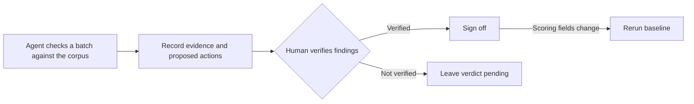

# Agent-assisted human review (#37)

Use this guide and review log to check the [synthetic questions](1-synthetic-questions.md)
against the corpus before relying on them to score E3SM Chat. The agent gathers
evidence for the expected documents and refusals; a human reviewer verifies
findings and signs off. If the corpus changes substantially, see [when to
rebuild the question set](#rebuild-the-question-set).

## Review setup

- **Scope:** All 100 questions in [`corpus/questions.json`](../../corpus/questions.json):
  80 answerable and 20 should-refuse. Reuse findings only if the question,
  scoring fields, and relevant evidence are unchanged.
- **Scoring fields:** `expected_documents` lists the corpus documents the app
  is expected to retrieve or cite. `should_refuse` says whether the app should
  decline because the corpus lacks enough evidence. `optional_documents`
  lists valid citations that do not count toward required recall.
- **Snapshot:** Use the same corpus snapshot throughout. SHA-256:
  `fa6a9a2d514aeda9f60306ba46024354eb2d69a23b9006cd8a299b53f7d9d626`.

## Review workflow



1. **Agent first pass:** Pilot one batch per section and spot-check its
   evidence before continuing. Run one batch per turn; if running sessions in
   parallel, assign distinct batches. Record each report in the results table
   and leave human verdicts pending.
2. **Human sign-off:** Check proposed scoring changes and ambiguous or
   unverified cases. Spot-check clean findings. Sign off only on verified
   rows; otherwise leave the verdict pending. Rerun the baseline after review
   if scoring fields changed. Review notes alone do not require a rerun.

## Answerable questions

Questions the corpus is expected to answer with sufficient evidence.

### Batch generation criteria

- Include every answerable question, including those reviewed before.
- Across all batches, cover all six feature areas, five answerable scenarios,
  and four personas.

### 1. Agent First Pass - Prompt

Paste this prompt into a coding agent with access to the repository and local
corpus. It checks whether the expected documents support a full answer for the
next batch with missing findings and reports its evidence without editing files.

```text
Read the Answerable questions section of
`evaluation/docs/2-agent-assisted-human-review.md`. In the results table, select
the lowest-numbered batch with a blank Agent finding. Review only its blank
rows. If no uncovered batch remains, stop.
Use corpus/questions.json and only sources in corpus/local/corpus-expanded.
Verify the recorded snapshot hash. Do not edit files. For each ID, open the source
passages and check whether expected_documents together support the full answer.
Check that optional_documents are valid citations but not needed for a complete
answer. Flag missing, redundant, or alternative sources and any version mismatch.
Report one row per ID: exact question and ID, agent finding (supported, partial,
unsupported, or unverified), Evidence (one bullet per source, with the source ID
and locator on their own line above the short quote),
Action (proposed dataset follow-up or no change), and Reference answer guidance
(if any). Leave the human verdict pending. Mark inaccessible evidence unverified.
```

<!-- Local snapshot (not tracked): corpus/local/corpus-expanded/captured/snapshot.json.
     Read source passages from the sibling content/ directory. -->

### 2. Human Sign-off Results

The agent’s findings and evidence, with the reviewer’s verdict once verified.

#### Sign-off steps

1. **Review changes and uncertain cases first.** Across both tables, check
   the cited evidence for proposed scoring changes and uncertain findings.
2. **Quick-check the rest by batch.** Use the agent’s citations rather than
   repeating the search. Sign off only on verified rows; leave the rest
   **Pending**.
3. **Apply approved changes together.** Mark actions complete after applying
   them. Rerun the baseline once if any scoring field changed.

#### Column legend

- **No.:** Question number in this review, continuing across both tables.
- **Batch:** Review group; `—` means no batch assigned.
- **Question:** Exact wording and ID from `corpus/questions.json`.
- **Agent finding:** Agent’s assessment of whether the evidence supports an answer.
- **Human verdict:** Sign off after verifying that the evidence supports the
  agent finding and any proposed Action. Otherwise, leave pending.
- **Evidence:** One bullet per source, with the citation on its own line.
  Refusal checks also list search terms.
- **Action:** Records proposed changes to the scoring fields in
  `corpus/questions.json`: `expected_documents` for which sources to expect,
  `optional_documents` for supporting sources, and `should_refuse` for whether
  to decline. It can also record other review
  tasks or no change. Mark `☐` as `☑` when done; the checkbox tracks completion
  separately from the **Human verdict**.
- **Reference answer guidance:** What a good model response should say or avoid.
  Reviewing this guidance is optional for sign-off.

| No. | Batch | Question | Agent finding | Human verdict | Evidence | Action | Reference answer guidance |
| ---: | --- | --- | --- | --- | --- | --- | --- |
| 1 | 1 | I want a copy of an existing case that keeps its user_nl edits and SourceMods. What command does that, and what should I avoid changing in the copy?<br>`syn-running-clone-case-newuser` | Supported | Signed off | • <code>cime.<wbr>doc.<wbr>source.<wbr>ccs.<wbr>cloning-<wbr>a-<wbr>case.<wbr>rst</code> L18–22:<br>`./scripts/create_clone --case <case> --clone <clone>`; L32–39: “preserves any local namelist modifications” and `SourceMods/`; “Do not change anything in the `env_case.xml` file.” L46–57: `--keepexe` links `SourceMods/` to the original; “No changes should be made to `env_build.xml` or `env_mach_pes.xml`.” | Keep the source. | Identify the new and original paths.<br>Use the plain command for an independent `SourceMods/` copy.<br>Distinguish the general warning from the `--keepexe` restrictions. |
| 2 | 1 | How do I turn on COSP satellite-simulator output in EAM, and what does cosp_lite change?<br>`syn-components-eam-cosp-developer` | Supported | Signed off | • <code>E3SM.<wbr>components.<wbr>eam.<wbr>docs.<wbr>tech-<wbr>guide.<wbr>cosp.<wbr>md</code> L15–19:<br>append `-cosp` to `CAM_CONFIG_OPTS` before `./case.setup`.<br>• <code>E3SM.<wbr>components.<wbr>eam.<wbr>docs.<wbr>user-<wbr>guide.<wbr>namelist_<wbr>parameters.<wbr>md</code> L161:<br>“sets cosp_ncolumns=10 and cosp_nradsteps=3” and runs MISR, ISCCP, MODIS, and CALIPSO lidar; default `false`.<br>• <code>e3sm-<wbr>run-<wbr>template</code> L154–166:<br>`cosp_lite = .true.` in `user_nl_eam` and `CLMODIS` in `fincl1`; L396–411 shows the `datm` exclusion. | ☑ Removed `e3sm-run-template` from `expected_documents`. The two guides cover enabling COSP and what `cosp_lite` changes; the template is an optional history-field example. | Tell users to append `-cosp` to `CAM_CONFIG_OPTS` before `./case.setup`, and explain that `cosp_lite` (off by default) sets `cosp_ncolumns=10` and `cosp_nradsteps=3` and runs the MISR, ISCCP, MODIS, and CALIPSO lidar simulators. |
| 3 | 1 | For the e3sm_diags QBO diagnostic, which variable and reference dataset are used by default, and does it need climatology or time-series input?<br>`syn-diagnostics-qbo-inputs-analyst` | Supported | Signed off | • <code>diags-<wbr>qbo-<wbr>defaults</code> L8–12:<br>`variables = ["U"]`, `ref_name = "ERA-Interim"`.<br>• <code>diags-<wbr>input-<wbr>requirements</code> L67–75:<br>“QBO: monthly `U`.”<br>• <code>diags-<wbr>qbo-<wbr>driver</code> L59–61:<br>`get_time_series_dataset(var_key)` for both inputs; L207 identifies zonal wind.<br>• <code>diags-<wbr>qbo-<wbr>parameter</code> L15–16<br>sets both time-series flags to `True`.<br>• <code>e3sm_<wbr>diags.<wbr>docs.<wbr>source.<wbr>available-<wbr>parameters.<wbr>rst</code> L230–240<br>documents both flags as `True`. | ☑ Set `optional_documents` to `diags-qbo-parameter`, `e3sm_diags.docs.source.available-parameters.rst`. | Identify `U` (zonal wind) and ERA-Interim as the defaults, and specify monthly time series for both test and reference, not climatologies. |
| 4 | 1 | In xCDAT 0.11.2, how do I drop incomplete DJF seasons when computing a seasonal climatology, and is drop_incomplete_djf still the right option?<br>`syn-tools-xcdat-djf-analyst` | Supported | Signed off | • <code>xcdat-<wbr>temporal-<wbr>api</code> L481–483, L614–623:<br>`ds.temporal.climatology("ts", "season", season_config={"dec_mode": "DJF", "drop_incomplete_seasons": True})`; `drop_incomplete_djf` “is being deprecated.” L1223–1237 shows the legacy path.<br>• Local <code>acquisition.<wbr>json</code> L9008–9013<br>maps the API revision to `v0.11.2`. | Keep the API as the sole expected answer source. | The old flag is superseded, not removed; the replacement drops incomplete seasons generally, including DJF. No version mismatch. |
| 5 | 1 | zstash check reported a checksum mismatch. What does that mean, and what should I do with my original data?<br>`syn-environment-zstash-checksum-researcher` | Supported | Signed off | • <code>zstash.<wbr>docs.<wbr>source.<wbr>best_<wbr>practices.<wbr>rst</code> L90–92, L106–114:<br>the extracted file’s MD5 “doesn't match the original one”; “try uploading it again.”<br>• <code>zstash.<wbr>docs.<wbr>source.<wbr>usage.<wbr>rst</code> L174–198:<br>“save your original data.” | Keep both sources. | Retain the originals, retry the upload if available, and verify the replacement archive before deleting anything.<br>Do not assume HPSS caused the mismatch. |
| 6 | 2 | My run crashed partway through a segment. How do I restart it from the last good restart files?<br>`syn-running-restart-after-crash-newuser` | Supported | Signed off | • <code>E3SM-<wbr>Project.<wbr>github.<wbr>io.<wbr>docs.<wbr>running-<wbr>e3sm-<wbr>guide.<wbr>guide-<wbr>production.<wbr>md</code> L83–90:<br>“Check that the rpointer files all point to the last restart”; `CONTINUE_RUN=TRUE`.<br>• <code>cime-<wbr>case-<wbr>run</code> L388–396, L498–499:<br>restore a consistent restart set to `$RUNDIR`; L139–149: `./case.submit`. | Keep both. | Distinguish reusing intact files from restoring a complete archived set. |
| 7 | 2 | Did the E3SM v3 water cycle simulations use prescribed leaf area index in ELM, as v1 and v2 did?<br>`syn-components-elm-phenology-v3-researcher` | Supported | Signed off | • <code>E3SM.<wbr>components.<wbr>elm.<wbr>docs.<wbr>user-<wbr>guide.<wbr>index.<wbr>md</code> L11–13:<br>v1/v2 used “a prescribed leaf area index”; v3 uses “interactive phenology” with active BGC. | Keep. | Scope the answer to the v3 water-cycle campaign. |
| 8 | 2 | zppy finished, how do i see the plots online<br>`syn-diagnostics-plots-online-vague-newuser` | Supported | Signed off | • <code>E3SM-<wbr>Project.<wbr>github.<wbr>io.<wbr>docs.<wbr>running-<wbr>e3sm-<wbr>guide.<wbr>guide-<wbr>documenting.<wbr>md</code> L79–100:<br>task URLs under `<www>`;<br>• <code>e3sm_<wbr>diags.<wbr>docs.<wbr>source.<wbr>quickguides.<wbr>quick-<wbr>guide-<wbr>general.<wbr>rst</code> L77–93:<br>machine web roots and portals.<br>• <code>E3SM-<wbr>Project.<wbr>github.<wbr>io.<wbr>docs.<wbr>running-<wbr>e3sm-<wbr>guide.<wbr>guide-<wbr>post-<wbr>processing.<wbr>md</code> L57–68<br>explains `www`.<br>• <code>zppy-<wbr>tutorial</code> L45–47<br>also explains `www`. | ☑ Set `optional_documents` to `E3SM-Project.github.io.docs.running-e3sm-guide.guide-post-processing.md`, `zppy-tutorial`. | Ask for the machine and `www` setting if an exact URL is needed. |
| 9 | 2 | What do I need to change to add a new HPC machine to mache and then to E3SM-Unified's deployment?<br>`syn-environment-mache-new-machine-developer` | Supported | Signed off | • <code>mache.<wbr>docs.<wbr>developers_<wbr>guide.<wbr>adding_<wbr>new_<wbr>machine.<wbr>md</code> L9–19, L27–49, L101–109:<br>E3SM machine-list prerequisite, `[parallel]`, and hostname detection.<br>• <code>e3sm-<wbr>unified.<wbr>docs.<wbr>releasing.<wbr>adding-<wbr>new-<wbr>machines.<wbr>md</code> L25–34, L40–73:<br>Spack and shell templates, test deployment with `--mache-fork` / `--mache-branch`. | Keep both. | Distinguish required setup from optional shell templates and conditional Spack changes. |
| 10 | 2 | The E3SM simulation tables have CMIP and Native ESGF links. What is the difference, and how do I download a dataset from ESGF?<br>`syn-data-esgf-cmip-native-newuser` | Supported | Signed off | • <code>data-<wbr>docs-<wbr>access</code> L145–168:<br>CMIP is “reformatted to CMIP conventions”; Native is output “as written by E3SM.” Filter, add files to the Data Cart, and run its wget script; Globus is available on supported nodes. | Keep. | Explain that CMIP is a subset reformatted to CMIP6 conventions and Native is model output as written, then direct users to filter the linked ESGF results, add files to the Data Cart, and download and run its `wget` script. |
| 11 | 3 | how fast is my run going? where do i see years per day<br>`syn-running-throughput-vague-newuser` | Supported | Signed off | • <code>E3SM-<wbr>Project.<wbr>github.<wbr>io.<wbr>docs.<wbr>running-<wbr>e3sm-<wbr>guide.<wbr>guide-<wbr>production.<wbr>md</code> L94–98:<br>`simulated_years` in `case_scripts/timing/e3sm*`;<br>• <code>cime.<wbr>doc.<wbr>source.<wbr>ccs.<wbr>timers.<wbr>rst</code> L57, L167–170:<br>“Model Throughput” in the timing file;<br>• <code>E3SM-<wbr>Project.<wbr>github.<wbr>io.<wbr>docs.<wbr>running-<wbr>e3sm-<wbr>guide.<wbr>guide-<wbr>documenting.<wbr>md</code> L72:<br>PACE “Experiment Details.” | ☑ Set `optional_documents` to `E3SM-Project.github.io.docs.running-e3sm-guide.guide-documenting.md`, `cime.doc.source.ccs.timers.rst`. | Lead with the timing-file lookup. |
| 12 | 3 | The EAM user guide lists 'A' twice for avgflag_pertape. Which flag actually gives instantaneous history output, and which values are valid?<br>`syn-components-eam-avgflag-analyst` | Supported | Signed off | • <code>e3sm-<wbr>eam-<wbr>user-<wbr>guide</code> L70<br>repeats `A`; L77 uses `I`.<br>• <code>e3sm-<wbr>eam-<wbr>namelist-<wbr>definitions</code> L68–76<br>lists `A`, `B`, `I`, `M`, and `X`; `I` is instantaneous. | ☑ Set `optional_documents` to `e3sm-eam-user-guide`.<br>Typo reported upstream in [E3SM#9249](https://github.com/E3SM-Project/E3SM/issues/9249). | Correct the typo: `I` is instantaneous; valid flags are `A` (average), `B` (GMT 00:00 average), `I` (instantaneous), `M` (minimum), and `X` (maximum). |
| 13 | 3 | Can e3sm_diags plot EAM output on its native ne30pg2 grid without regridding, and which version added that?<br>`syn-diagnostics-diags-native-grid-analyst` | Supported | Signed off | • <code>e3sm_<wbr>diags.<wbr>docs.<wbr>source.<wbr>available-<wbr>parameters.<wbr>rst</code> L277–282:<br>`lat_lon_native` “v3.1.0+” uses UXarray and a required test UGRID file such as `ne30pg2.nc`. | Keep. | Note the reference grid requirement for model-vs-model runs. |
| 14 | 3 | How do I split daily (sub-monthly) EAM output into time series for e3sm_to_cmip?<br>`syn-tools-ncclimo-highfreq-researcher` | Supported | Signed off | • <code>e3sm_<wbr>to_<wbr>cmip.<wbr>docs.<wbr>source.<wbr>high_<wbr>freq.<wbr>rst</code> L18–31:<br>`--clm_md=hfs`, then use the extracted series path and appropriate `--freq`;<br>• <code>nco-<wbr>manual</code> L1176–1188:<br>`hfs` invokes splitting, with `--split` and `--ypf` as alternatives. | Keep both. | If quoting the example, fix the shell expansion to `-o "${native_out}"`. |
| 15 | 3 | How does e3sm_to_cmip map an E3SM variable like TREFHT to a CMIP6 variable, and how would I add a new mapping?<br>`syn-environment-e2c-handlers-developer` | Supported | Signed off | • <code>e3sm_<wbr>to_<wbr>cmip.<wbr>docs.<wbr>source.<wbr>var-<wbr>handlers.<wbr>rst</code> L24–33:<br>`tas`, `K`, `[TREFHT]`, `CMIP6_Amon.json`; L106–112: add the mapping to `handlers.yaml` and a function to `_formulas.py` only if needed. | Keep. | Distinguish a direct mapping from a formula. |
| 16 | 4 | is the 2 degree ocean mesh ok for a quick science run<br>`syn-components-mpaso-oqu240-vague-newuser` | Supported | Signed off | • <code>E3SM.<wbr>components.<wbr>mpas-<wbr>ocean.<wbr>docs.<wbr>user-<wbr>guide.<wbr>index.<wbr>md</code> L61–63:<br>`T62_oQU240` is “CORE-II only,” for “rapid testing,” “not production,” and “not scientifically validated.” | Keep. | Recommend for testing, not science results. |
| 17 | 4 | My zppy e3sm_diags model-vs-model task compared my run against observations instead of my control run. Why, and what should I set?<br>`syn-diagnostics-zppy-reference-path-analyst` | Supported | Signed off | • <code>zppy.<wbr>docs.<wbr>source.<wbr>parameters.<wbr>rst</code> L74–76, L90–94:<br>the default points to observations; use the “specific directory containing the reference climatology files.”<br>• <code>mache.<wbr>docs.<wbr>users_<wbr>guide.<wbr>quick_<wbr>start.<wbr>md</code> L58–59<br>illustrates `[diagnostics] base_path`. | ☑ Set `optional_documents` to `mache.docs.users_guide.quick_start.md`. | Point to the control climatology directory, not its output root. |
| 18 | 4 | ncremap gives bad results for fields with dimensions ordered lat, lev, lon. What is wrong and how do I fix it?<br>`syn-tools-ncremap-dim-order-analyst` | Supported | Signed off | • <code>nco-<wbr>manual</code> L6072–6081:<br>horizontal dimensions must be the “final two dimensions”; `lat,lev,lon` “will not regrid properly.” Use `ncpdq` before regridding and undo the permutation afterward. | Keep. | Give `lev,lat,lon` as the pre-remap order. |
| 19 | 4 | can i use e3sm unified on windows<br>`syn-environment-unified-windows-vague-newuser` | Supported | Signed off | • <code>e3sm-<wbr>unified.<wbr>docs.<wbr>introduction.<wbr>md</code> L54–55:<br>“Windows is not supported.”<br>• <code>unified-<wbr>readme</code> L21–22<br>confirms the same restriction.<br>• <code>unified-<wbr>quickstart</code> L7–10, L80–82<br>also confirms it. | ☑ Set `optional_documents` to `e3sm-unified.docs.introduction.md`, `unified-readme`. | Do not imply WSL support. |
| 20 | 4 | How do I reproduce the v2.LR.piControl simulation bit-for-bit, and which machine do I need?<br>`syn-data-reproduce-v2-researcher` | Supported | Signed off | • <code>e3sm_<wbr>data_<wbr>docs.<wbr>docs.<wbr>source.<wbr>v2.<wbr>WaterCycle.<wbr>reproducing_<wbr>simulations.<wbr>index.<wbr>rst</code> L13–17, L28–64:<br>use `chrysalis`, retrieve the run script and initial conditions, run the test, and compare the 10-day atmospheric-log checksum.<br>• <code>e3sm_<wbr>data_<wbr>docs.<wbr>docs.<wbr>source.<wbr>v2.<wbr>WaterCycle.<wbr>reproducing_<wbr>simulations.<wbr>reproduction_<wbr>table.<wbr>rst</code> L24–28<br>corroborates the machine and checksum. | ☑ Set `optional_documents` to `e3sm_data_docs.docs.source.v2.WaterCycle.reproducing_simulations.reproduction_table.rst`. | The checksum verifies the documented 10-day test, not the full production run. |
| 21 | 5 | How can I tell from the logs whether my E3SM job ran out of wallclock time or the model actually crashed?<br>`syn-running-timeout-vs-crash-developer` | Supported | Signed off | • <code>cime.<wbr>doc.<wbr>source.<wbr>ccs.<wbr>troubleshooting.<wbr>rst</code> L61–72:<br>check component logs, stdout/stderr, and scheduler email. L79–86: timeout “often produces minimal error messages”; use `cpl.log` and file timestamps. L123–124: identify “what component is aborting the run.” | Keep. | Compare elapsed time with the wallclock limit and look for explicit aborts. A silent stop is not proof of timeout, and a hang can end in one. |
| 22 | 5 | my e3sm job just died with no obvious error, where do i even look<br>`syn-running-job-died-vague-newuser` | Supported | Signed off | • <code>cime-<wbr>case-<wbr>run</code> L168–170, L216–226:<br>`CaseStatus` records job states; “Start with the STDOUT and STDERR” in `$CASEROOT`, then check `cpl.log.$datestamp` and component logs in `$RUNDIR`.<br>• <code>cime.<wbr>doc.<wbr>source.<wbr>ccs.<wbr>troubleshooting.<wbr>rst</code> L45, L61–75<br>adds “SUCCESSFUL TERMINATION,” scheduler email, and archive checks. | Keep both. `E3SM-Project.github.io.docs.running-e3sm-guide.guide-production.md` L49–55 is optional for locating `run/e3sm.log.*`. | Start with stdout and stderr in `$CASEROOT`, then check the coupler log in `$RUNDIR` for when the run failed and the other component logs for clues about why. |
| 23 | 5 | Before a long production run, which short tests should I run to confirm restarts and PE-layout changes are bit-for-bit, and how do I compare the results?<br>`syn-running-bfb-short-tests-developer` | Supported | Signed off | • <code>site-<wbr>pre-<wbr>production</code> L102, L121–133, L145–157:<br>run `S_2x5_ndays` and `M_1x10_ndays`; extract `nstep, te` and compare `md5sum`.<br>• <code>e3sm-<wbr>run-<wbr>template</code> L60–83<br>implements the settings and defaults to `XS_2x5_ndays`. | ☑ Set `optional_documents` to `e3sm-run-template`. | The guide links `master`, but the capture is v3.1.0. Matching hashes verify the logged atmospheric integral, not every field. For separate checks, `cime.doc.source.system_testing.rst` L221–225, L256–277 documents ERS, PEM/PET, and combined ERP. |
| 24 | 5 | How do I list the compsets and grids my E3SM checkout supports before I create a case?<br>`syn-running-query-config-newuser` | Supported | Signed off | • <code>cime.<wbr>doc.<wbr>source.<wbr>ccs.<wbr>query-<wbr>configuration.<wbr>rst</code> L79–91, L107–119:<br>`./scripts/query_config --compsets` and `./scripts/query_config --grids`.<br>• <code>E3SM.<wbr>components.<wbr>mpas-<wbr>ocean.<wbr>docs.<wbr>user-<wbr>guide.<wbr>index.<wbr>md</code> L46–51, L65–70<br>gives equivalent commands after `cd cime/scripts`. | ☑ Set `optional_documents` to `E3SM.components.mpas-ocean.docs.user-guide.index.md`. | Give the checkout-relative `./cime/scripts/query_config` commands. Listing entries does not validate a pairing. |
| 25 | 5 | How do I create an F2010 atmosphere-only case on the supported ne30pg2 grid, and which components does F2010 include?<br>`syn-running-f2010-case-newuser` | Supported | Signed off | • <code>cime-<wbr>case-<wbr>create</code> L50–57:<br>`create_newcase --case … --compset … --res …`.<br>• <code>e3sm-<wbr>eam-<wbr>user-<wbr>guide</code> L24–40<br>names `F2010` and `ne30pg2_r05_IcoswISC30E3r5`.<br>• <code>e3sm-<wbr>eam-<wbr>compsets</code> L69–72:<br>`2010_EAM%CMIP6_ELM%CNPRDCTCBCTOP_MPASSI%PRES_DOCN%DOM_MOSART_SGLC_SWAV`. | Keep all three; they agree for v3.1.0 and bundled CIME. | Use the full grid alias. “Atmosphere-only” still includes ELM, prescribed MPAS sea ice, data ocean, MOSART, and glacier/wave stubs. |
| 26 | 6 | Which files does case.setup generate in my case directory, and where do I put my own namelist changes?<br>`syn-running-case-setup-files-newuser` | Supported | Signed off | • <code>cime-<wbr>case-<wbr>setup</code> L354–368<br>lists `.case.run`, `Macros.cmake`, `cmake_macros/`, and `user_nl_xxx[_NNNN]`, among other files. L101–118: edit `$CASEROOT/user_nl_<comp>`; `CaseDocs/` “SHOULD NOT BE EDITED.” | Keep. | Distinguish overrides from generated files.<br>Use E3SM component names, not the CESM examples. |
| 27 | 6 | where is the official step by step guide for running e3sm<br>`syn-running-guide-index-vague-newuser` | Supported | Signed off | • <code>site-<wbr>running-<wbr>guide-<wbr>index</code> L5–11:<br>“The step-by-step guide to running E3SM”;<br>• <code>e3sm-<wbr>eam-<wbr>user-<wbr>guide</code> L20–22<br>gives the public URL. | ☑ Set `optional_documents` to `e3sm-eam-user-guide`. | Link to `https://docs.e3sm.org/running-e3sm-guide/`; the live guide is not release-pinned. |
| 28 | 6 | I only want TG, TV, and FSA in my monthly ELM output, plus a separate daily file. What goes in user_nl_elm?<br>`syn-components-elm-output-analyst` | Supported | Signed off | • <code>E3SM.<wbr>components.<wbr>elm.<wbr>docs.<wbr>user-<wbr>guide.<wbr>index.<wbr>md</code> L30–44:<br>`hist_empty_htapes = .true.`, `hist_fincl1 = 'TG', 'TV', 'FSA'`. L47–67: `hist_fincl2 = 'TG'`, `0` for monthly, `-24` for daily. | Keep. | Show `hist_nhtfrq = 0, -24` and a separate `hist_fincl2` list. Daily variables and records per file are user choices. |
| 29 | 6 | How do I turn on reservoir water management in MOSART, and what extra inputs does it need?<br>`syn-components-mosart-water-management-researcher` | Supported | Signed off | • <code>E3SM.<wbr>components.<wbr>mosart.<wbr>docs.<wbr>user-<wbr>guide.<wbr>index.<wbr>md</code> L100–105:<br>`wrmflag = .true.` activates management. L112–122: `parafile` describes dams/reservoirs; monthly `demandpath` files are required with `externaldemandflag = 1`. | Keep. | Separate required reservoir parameters from conditional demand files.<br>Use `user_nl_mosart`, not the `usr_nl_mosart` typo. |
| 30 | 6 | atmchange says my parameter name is ambiguous. How do I change number_of_subcycles for HOMME only?<br>`syn-components-eamxx-atmchange-developer` | Supported | Signed off | • <code>E3SM.<wbr>components.<wbr>eamxx.<wbr>docs.<wbr>user.<wbr>model_<wbr>configuration.<wbr>md</code> L177–197:<br>`./atmchange homme::number_of_subcycles=10`, then `./atmquery homme::number_of_subcycles`. | Keep. | Use the qualified path.<br>Omit the example’s unrelated `internal_diagnostics_level` error text. |
| 31 | 7 | How do I nudge EAMxx toward reanalysis winds and temperature while leaving my refined region free-running?<br>`syn-components-eamxx-nudging-researcher` | Supported | Signed off | • <code>E3SM.<wbr>components.<wbr>eamxx.<wbr>docs.<wbr>user.<wbr>nudging.<wbr>md</code> L12–28, L30–44:<br>`U`, `V`, `T_mid`; set `use_nudging_weights` and `nudging_weights_file` with “zeros in the refined region”; data must be on the target grid.<br>• <code>E3SM.<wbr>components.<wbr>eamxx.<wbr>docs.<wbr>user.<wbr>rrm_<wbr>eamxx.<wbr>md</code> L23–33<br>corroborates. | ☑ Set `optional_documents` to `E3SM.components.eamxx.docs.user.rrm_eamxx.md`. | Explain input and pressure conventions and preserve existing physics processes when adding nudging. The linked `master` weight generator was not verified. |
| 32 | 7 | How do I set up an ocean and sea-ice-only run forced by JRA55, and which mesh goes with it?<br>`syn-components-mpaso-gcase-newuser` | Partial | Signed off | • <code>E3SM.<wbr>components.<wbr>mpas-<wbr>ocean.<wbr>docs.<wbr>user-<wbr>guide.<wbr>index.<wbr>md</code> L29–37, L55–63:<br>`GMPAS-JRA1p5` uses “JRA55 v1.5” and `TL319_IcoswISC30E3r5` is the JRA mesh.<br>• <code>cime-<wbr>case-<wbr>create</code> L50–57<br>supplies the missing `create_newcase --case … --compset … --res …` syntax. | ☑ Added `cime-case-create` to `expected_documents`, kept the MPAS-Ocean guide, and updated the scenario to `multi-document`. | Use `create_newcase` with `--compset GMPAS-JRA1p5` and `--res TL319_IcoswISC30E3r5`; distinguish this pairing from CORE-II and ocean-only `CMPASO`. |
| 33 | 7 | fates in elm - where are the docs<br>`syn-components-fates-docs-vague-developer` | Supported | Signed off | • <code>E3SM.<wbr>components.<wbr>elm.<wbr>docs.<wbr>user-<wbr>guide.<wbr>fates.<wbr>md</code> L16–25<br>links the “FATES Technical Document,” “User's guide,” and “Developer's guide.” | Keep. | Lead with the developer guide. The links target `latest` or `stable`, not a pinned FATES release. |
| 34 | 7 | My EAMxx change isn't bit-for-bit. How can I test whether it changes the model climate statistically?<br>`syn-components-eamxx-rcs-developer` | Supported | Signed off | • <code>E3SM.<wbr>components.<wbr>eamxx.<wbr>docs.<wbr>user.<wbr>multi-<wbr>instance-<wbr>rcs.<wbr>md</code> L39–48:<br>“two ensembles of one-year runs.” L349–388 gives `RCS_P4_C4…eamxx-perturb` and `rcs_stats.py /run/dir /base/dir`. | Keep. | Compare perturbed baseline and changed ensembles; standalone analysis is an alternative. Passing means no difference was detected under the test settings. |
| 35 | 7 | How do I create an ELM initial condition file for a new grid from an existing simulation's land restart file?<br>`syn-components-elm-interpinic-developer` | Supported | Signed off | • <code>E3SM.<wbr>components.<wbr>elm.<wbr>docs.<wbr>user-<wbr>guide.<wbr>interpinic.<wbr>md</code> L8–18<br>calls for a restart at the “new resolution”; L30–55 copies a target-grid IC and builds the tool; L77–82 runs `interpinic -i … -o …`. | Keep. | `-o` is a prepared copy of a target-grid IC/restart, not just a new filename.<br>Adapt compiler and batch settings. |
| 36 | 8 | I set use_od_ls = .true. in user_nl_eam and left the default orographic gravity-wave drag on. Is that a problem?<br>`syn-components-eam-orodrag-developer` | Supported | Signed off | • <code>E3SM.<wbr>components.<wbr>eam.<wbr>docs.<wbr>user-<wbr>guide.<wbr>namelist_<wbr>parameters.<wbr>md</code> L167–172:<br>`use_gw_oro` defaults to `true`; `use_od_ls` “should not be used at the same time with use_gw_oro.” | Keep. | Set `use_gw_oro = .false.` to use nonlinear drag. |
| 37 | 8 | I ran e3sm_diags on Chrysalis. Where do I put the results so I can view them in a web browser?<br>`syn-diagnostics-diags-web-chrysalis-newuser` | Supported | Signed off | • <code>e3sm_<wbr>diags.<wbr>docs.<wbr>source.<wbr>quickguides.<wbr>quick-<wbr>guide-<wbr>chrysalis.<wbr>rst</code> L59–64, L176–181<br>gives `/lcrc/group/e3sm/public_html/diagnostic_output/<username>/` and `viewer/index.html`.<br>• <code>e3sm_<wbr>diags.<wbr>docs.<wbr>source.<wbr>quickguides.<wbr>quick-<wbr>guide-<wbr>general.<wbr>rst</code> L56–66<br>confirms the web root. | ☑ Set `optional_documents` to `e3sm_diags.docs.source.quickguides.quick-guide-general.rst`. | Place the whole result directory under the web root and ensure it is readable. |
| 38 | 8 | Both e3sm_diags and MPAS-Analysis do ENSO or Niño index analysis. Which Niño regions can each use, and what are the defaults?<br>`syn-diagnostics-enso-regions-researcher` | Supported | Signed off | • <code>MPAS-<wbr>Analysis.<wbr>docs.<wbr>users_<wbr>guide.<wbr>tasks.<wbr>indexNino34.<wbr>rst</code> L27–40:<br>`nino3`, `nino4`, or `nino3.4`, “one value at a time”; default `nino3.4`.<br>• <code>e3sm_<wbr>diags.<wbr>docs.<wbr>source.<wbr>available-<wbr>parameters.<wbr>rst</code> L210:<br>`NINO3`, `NINO34` “(the default),” or `NINO4`. | Keep both. | Preserve spelling and casing. |
| 39 | 8 | How do I add my own derived variable to e3sm_diags without changing the package code?<br>`syn-diagnostics-diags-derived-variable-developer` | Supported | Signed off | • <code>e3sm_<wbr>diags.<wbr>docs.<wbr>source.<wbr>add-<wbr>new-<wbr>diagnostics.<wbr>rst</code> L21–43:<br>runtime mappings override collisions and “cannot be added to json/cfg files.” L123–134 shows `param.derived_variables` and `-d mydiags.cfg`. | Keep. | Put the callable and input tuple in the Python parameters script.<br>Select its output key in the diagnostics config. |
| 40 | 8 | The zppy in E3SM-Unified is older than the release I need. How do I install the latest zppy myself?<br>`syn-diagnostics-zppy-install-latest-analyst` | Supported | Signed off | • <code>zppy.<wbr>docs.<wbr>source.<wbr>getting_<wbr>started.<wbr>rst</code> L63–75, L146–166:<br>`mamba create -n zppy_env zppy`, `conda activate zppy_env`, and `mamba update zppy`. | Keep. | Use conda-forge and a separate environment.<br>Omit the legacy installer; the captured v3.2.0 does not establish the current latest version.<br>Do not recommend disabling SSL verification. If mentioned, explain that the workaround for networks that intercept SSL turns off certificate checks; direct users with SSL errors to their site administrators for certificate setup. |
| 41 | 9 | MPAS-Analysis crashes while ncclimo builds climatologies, probably out of memory. What should I change?<br>`syn-diagnostics-mpas-ncclimo-memory-analyst` | Supported | Signed off | • <code>MPAS-<wbr>Analysis.<wbr>docs.<wbr>users_<wbr>guide.<wbr>config.<wbr>execute.<wbr>rst</code> L75–93:<br>use “fewer threads” (`ncclimoThreads` a factor of 12), serial, or MPI across nodes.<br>• <code>nco-<wbr>manual</code> L970–977<br>documents the modes. | ☑ Set `optional_documents` to `nco-manual`. | Reduce threads in `bck`/`mpi`, use serial, or spread work across nodes. The non-HPC NCO capture does not pin the HPC build. |
| 42 | 9 | I launched zppy. How do I check which of its jobs failed?<br>`syn-diagnostics-zppy-status-newuser` | Supported | Signed off | • <code>E3SM-<wbr>Project.<wbr>github.<wbr>io.<wbr>docs.<wbr>running-<wbr>e3sm-<wbr>guide.<wbr>guide-<wbr>post-<wbr>processing.<wbr>md</code> L116–137:<br>`post/scripts`, `WAITING, RUNNING, OK, ERROR`, and `.o<job ID>` logs.<br>• <code>zppy-<wbr>tutorial</code> L91–100:<br>“Review `.o` files corresponding to failed `.status` files.” | Either source suffices. | Look for `ERROR`; `grep -v "OK"` also shows unfinished jobs. |
| 43 | 9 | I want to compare my model's surface air temperature climatology with ERA-Interim in e3sm_diags. Is there an official example I can copy and adapt?<br>`syn-diagnostics-ex5-model-vs-obs-analyst` | Supported | Signed off | • <code>diags-<wbr>ex5-<wbr>config</code> L8–13:<br>`TREFHT`, `ERA-Interim`.<br>• <code>diags-<wbr>ex5-<wbr>python</code> L13–30<br>sets input/result paths and `lat_lon`;<br>• <code>diags-<wbr>examples</code> L245–246<br>runs `python ex5.py … -d diags.cfg`. | Keep all three. | Adapt the paths and use the captured v3.2.0 examples instead of assuming `master` or the old NERSC paths match. |
| 44 | 9 | Which observational datasets does the default e3sm_diags lat_lon model-vs-obs set compare precipitation (PRECT) against?<br>`syn-diagnostics-latlon-precip-refs-analyst` | Supported | Signed off | • <code>diags-<wbr>lat-<wbr>lon-<wbr>defaults</code> L9–13, L24–28, L687–691, L959–963:<br>`PRECT` against `GPCP_v3.2`, `GPCP_v2.3`, `ERA5`, and `MERRA2`. | Keep. | Scope to captured v3.2.0 defaults. |
| 45 | 9 | After changing e3sm_diags code, how do I run its tests, and what do I do when integration-test images differ from the expected ones?<br>`syn-diagnostics-diags-tests-developer` | Supported | Signed off | • <code>diags-<wbr>testing</code> L12–30:<br>`./tests/test.sh`, inspect `tests/integration/image_check_failures`; investigate unexpected changes. L35–49 covers replacing intended baselines and rerunning. | Keep. | Update only reviewed, intended baselines with access to the shared directory. Image agreement does not establish metric equality. |
| 46 | 10 | My zppy climo jobs need a newer NCO than the one in E3SM-Unified. What does the climo task run, and how do I point zppy at a different NCO build?<br>`syn-diagnostics-zppy-nco-path-developer` | Supported | Signed off | • <code>zppy-<wbr>climo-<wbr>template</code> L23–53, L102–125:<br>`run_nco ncclimo`, with `hfc` for diurnal climo.<br>• <code>zppy-<wbr>defaults</code> L54–62:<br>`ncclimo_cmd` is “DEPRECATED”; set `nco_path`.<br>• <code>zppy-<wbr>boilerplate</code> L54–65<br>calls the override script with `--npo`. | Keep all three. | Set `[default] nco_path` to the executable directory.<br>Verify actual binaries in the job: `nco-ncclimo` L674 documents the machine-path override; the HPC NCO build is not recorded. |
| 47 | 10 | Which e3sm_diags sets does zppy run if I don't list any, and where does its e3sm_diags job look for the climatology files made by the climo task?<br>`syn-diagnostics-zppy-default-sets-analyst` | Supported | Signed off | • <code>zppy-<wbr>defaults</code> L262–267:<br>`lat_lon`, `zonal_mean_xy`, `zonal_mean_2d`, `polar`, `cosp_histogram`, `meridional_mean_2d`, `annual_cycle_zonal_mean`, `zonal_mean_2d_stratosphere`, `aerosol_aeronet`, `aerosol_budget`.<br>• <code>zppy-<wbr>diags-<wbr>template</code> L54–64, L109–117<br>links files from `<output>/post/atm/<grid>/clim/<N>yr`. | Keep both. | Scope the set list to v3.2.0.<br>Explain that matching climos are linked into the task’s working directory. |
| 48 | 10 | How do I set up zppy to make a diurnal-cycle climatology of PRECT from 3-hourly eam.h4 output?<br>`syn-diagnostics-zppy-diurnal-analyst` | Supported | Signed off | • <code>zppy-<wbr>tutorial-<wbr>config</code> L16–32:<br>`[climo]` active, `input_subdir = "archive/atm/hist"`, `input_files = "eam.h4"`, `vars = "PRECT"`, `frequency = "diurnal_8xdaily"`. L101–104 covers plotting settings. | Keep. | Adapt years, archive path, and mapping file. Plotting configuration is optional for generating climos. |
| 49 | 10 | To reproduce E3SM seasonal and annual climatologies outside NCO, how does ncclimo weight the months when it averages them?<br>`syn-tools-ncclimo-month-weights-researcher` | Supported | Signed off | • <code>nco-<wbr>manual</code> L2093–2114:<br>average calendar months across years, then weight “each input month by its number of days” and each season by its days, on a 365-day calendar. | Keep. | Account for intermediate precision when reproducing results.<br>Don’t generalize fixed weights to leap calendars. |
| 50 | 10 | How do I turn a folder of monthly EAM history files into one time-series file per variable?<br>`syn-tools-ncclimo-split-newuser` | Supported | Signed off | • <code>nco-<wbr>manual</code> L1163–1192, L1400–1433:<br>`--split` makes “per-variable timeseries”; default segments are at most 50 years.<br>• <code>nco-<wbr>ncclimo</code> L316–325<br>shows explicit split examples;<br>• <code>diags-<wbr>input-<wbr>requirements</code> L39–59<br>shows legacy examples and filenames. | ☑ Set `optional_documents` to `diags-input-requirements`, `nco-ncclimo`. | Use explicit `--split` and only monthly EAM files. The older examples omit `--split`; a file list alone no longer selects splitting in NCO 5.0.4+. |
| 51 | 11 | xcdat.open_mfdataset fails with 'MergeError: conflicting values' for the bounds across my E3SM files. How do I work around it?<br>`syn-tools-xcdat-mergeerror-analyst` | Supported | Signed off | • <code>xcdat.<wbr>docs.<wbr>getting-<wbr>started-<wbr>guide.<wbr>faqs.<wbr>rst</code> L195–232:<br>`compat="override"`, minimal variables and coordinates, matching-size indexes. L240–251: `drop_variables` and regenerate via `add_bounds`. | Keep both alternatives. | Override only if grids and bounds should agree.<br>Regenerate only if inferred bounds are appropriate. |
| 52 | 11 | What Python and xarray versions does the xCDAT 0.11.2 conda package require?<br>`syn-tools-xcdat-deps-developer` | Supported | Signed off | • <code>xcdat-<wbr>recipe</code> L7–8, L28–41:<br>`0.11.2`, `python_min = "3.11"`, runtime `python >=3.11` and `xarray >=2024.03.0`. | Keep. | Report runtime minimums, not build/test pins. No version mismatch. |
| 53 | 11 | How do I set up xCDAT in Jupyter on an HPC machine?<br>`syn-tools-xcdat-hpc-jupyter-newuser` | Supported | Signed off | • <code>xcdat.<wbr>docs.<wbr>getting-<wbr>started-<wbr>guide.<wbr>getting-<wbr>started-<wbr>hpc-<wbr>jupyter.<wbr>rst</code> L44–59, L67–96:<br>use conda-forge, install `ipykernel`, run `python -m ipykernel install --user …`, then “Change Kernel.” | Keep. | Register the kernel from inside the xCDAT environment and use the site’s Jupyter service. |
| 54 | 11 | My dataset has no latitude or longitude bounds. How does xCDAT generate missing bounds, and what happens to auxiliary coordinates such as a second latitude variable?<br>`syn-tools-xcdat-bounds-developer` | Supported | Signed off | • <code>xcdat.<wbr>docs.<wbr>getting-<wbr>started-<wbr>guide.<wbr>faqs.<wbr>rst</code> L64–71, L86–98:<br>coordinate points are “the midpoint between their lower and upper bounds”; auxiliary coordinates “are ignored.” | Keep. | A second latitude can get bounds if it is a dimension coordinate, not merely an auxiliary latitude. |
| 55 | 11 | Where should I run zstash at NERSC for the best transfer speed, and how do I keep it running after I log out?<br>`syn-environment-zstash-dtn-newuser` | Supported | Signed off | • <code>zstash.<wbr>docs.<wbr>source.<wbr>best_<wbr>practices.<wbr>rst</code> L17–35:<br>use a NERSC DTN and `screen`; detach with “CTRL-A followed by D.”<br>• <code>zstash.<wbr>docs.<wbr>source.<wbr>getting_<wbr>started.<wbr>rst</code> L165–171<br>covers manual Conda activation.<br>• <code>E3SM-<wbr>Project.<wbr>github.<wbr>io.<wbr>docs.<wbr>running-<wbr>e3sm-<wbr>guide.<wbr>guide-<wbr>long-<wbr>term-<wbr>archiving.<wbr>md</code> L149–165<br>shows reconnecting. | ☑ Set `optional_documents` to `E3SM-Project.github.io.docs.running-e3sm-guide.guide-long-term-archiving.md`, `zstash.docs.source.getting_started.rst`. | Reconnect to the same node for `screen -r`; the hostname examples are not verified live.<br>Do not recommend disabling SSL verification. If mentioned, explain that the workaround for networks that intercept SSL turns off certificate checks; direct users with SSL errors to their site administrators for certificate setup. |
| 56 | 12 | e3sm_to_cmip wants atmosphere input as regridded time series named like PRECC_185001_201412.nc. How do I produce those from raw EAM output?<br>`syn-environment-e2c-atm-prep-researcher` | Supported | Signed off | • <code>e3sm_<wbr>to_<wbr>cmip.<wbr>docs.<wbr>source.<wbr>preprocessing.<wbr>rst</code> L13–23<br>requires “regridded time-series files” such as `PRECC_185001_201412.nc`.<br>• <code>nco-<wbr>manual</code> L1376–1433<br>covers splitting and years per file; L1543–1563 shows `-r map_fl -O drc_rgr`. | Keep both. | Split monthly EAM output per variable and remap with a matching map.<br>Use `--ypf` of at least 165 for one 1850–2014 file; shorter segments are accepted.<br>Apply `plev19` only where required. |
| 57 | 12 | e3sm_to_cmip says I need a tables path. Where do I get the CMOR tables?<br>`syn-environment-e2c-tables-newuser` | Supported | Signed off | • <code>e3sm_<wbr>to_<wbr>cmip.<wbr>docs.<wbr>source.<wbr>getting-<wbr>started.<wbr>rst</code> L86–106:<br>`git clone https://github.com/PCMDI/cmip6-cmor-tables.git`;<br>• <code>e3sm_<wbr>to_<wbr>cmip.<wbr>docs.<wbr>source.<wbr>usage.<wbr>rst</code> L114–120:<br>“point to the ‘Tables’ directory.” | ☑ Set `optional_documents` to `e3sm_to_cmip.docs.source.getting-started.rst`. | Pass `-t /path/to/cmip6-cmor-tables/Tables`, not the user metadata JSON. No tables revision is specified. |
| 58 | 12 | how do i look at mpas ocean output in paraview<br>`syn-environment-paraview-vague-analyst` | Supported | Signed off | • <code>MPAS-<wbr>Tools.<wbr>conda_<wbr>package.<wbr>docs.<wbr>mpas_<wbr>to_<wbr>xdmf.<wbr>rst</code> L65–73, L151–172:<br>`mpas_to_xdmf`; open `.xdmf`, not `.h5`.<br>• <code>MPAS-<wbr>Tools.<wbr>conda_<wbr>package.<wbr>docs.<wbr>paraview_<wbr>extractor.<wbr>rst</code> L74–123<br>extracts VTK and opens `fieldsOnCells.pvd`. | ☑ Kept the XDMF guide required and moved the VTK guide to `optional_documents`. VTK is a valid citation but does not substitute for XDMF in recall. | Lead with XDMF and offer VTK extraction for cell-based visualization. |
| 59 | 12 | How do I create better-balanced graph partition files for MPAS-Seaice?<br>`syn-environment-seaice-partition-developer` | Supported | Signed off | • <code>MPAS-<wbr>Tools.<wbr>conda_<wbr>package.<wbr>docs.<wbr>seaice.<wbr>partition.<wbr>rst</code> L73–109:<br>`prepare_seaice_partitions` remaps `icePresence`. L115–152: `create_seaice_partitions` uses `gpmetis`, with one partition file per processor count. | Keep. | Explain mesh and presence inputs.<br>Use a processor-count list for several partitions. |
| 60 | 12 | After sourcing the E3SM-Unified load script, how do I check that the environment loaded correctly and which package variant is active?<br>`syn-environment-unified-verify-newuser` | Supported | Signed off | • <code>unified-<wbr>quickstart</code> L49–68:<br>import `xarray, e3sm_diags, mpas_analysis, zppy` and `echo "$E3SMU_MPI"`; `SYSTEM` denotes `hpc`.<br>• <code>e3sm-<wbr>unified.<wbr>docs.<wbr>troubleshooting.<wbr>md</code> L40–52<br>adds re-sourcing and `conda list e3sm-unified` for local installs. | ☑ Set `optional_documents` to `e3sm-unified.docs.troubleshooting.md`. | Check in the target shell or allocation, since login and compute environments can differ. |
| 61 | 13 | How can my Python script detect which E3SM machine it is running on and find the shared diagnostics directory?<br>`syn-environment-mache-detect-developer` | Supported | Signed off | • <code>mache.<wbr>docs.<wbr>users_<wbr>guide.<wbr>quick_<wbr>start.<wbr>md</code> L23–32:<br>`discover_machine()` and `MachineInfo().config.get('diagnostics', 'base_path')`; L48–59 shows the example diagnostics path. | Keep. | Read the machine configuration rather than hard-coding the sample path. |
| 62 | 13 | I ran zstash update to add new files, but zstash ls doesn't show them. Why?<br>`syn-environment-zstash-ls-cache-analyst` | Supported | Signed off | • <code>zstash.<wbr>docs.<wbr>source.<wbr>usage.<wbr>rst</code> L484–487:<br>`index.db` is fetched only “if a local archive (cache) is not present.” L499–509 reproduces the issue after `update`. | Keep. | Use the updated cache in the source directory or a fresh directory to retrieve the remote index.<br>Don’t delete a cache that might be the only archive copy. |
| 63 | 13 | what tar size should zstash use<br>`syn-environment-zstash-tar-size-vague-analyst` | Supported | Signed off | • <code>zstash.<wbr>docs.<wbr>source.<wbr>best_<wbr>practices.<wbr>rst</code> L49–55:<br>`--maxsize 128`; documented NERSC range “100 and 500 GB.”<br>• <code>zstash.<wbr>docs.<wbr>source.<wbr>usage.<wbr>rst</code> L59–62:<br>default `256 GB`; “individual files are never split up.” | Keep both. | Distinguish the default, HPSS guidance, and the oversized-file exception.<br>Ask about the destination before recommending tuning. |
| 64 | 13 | How can I build a machine-correct srun or mpiexec command for my workflow with mache?<br>`syn-environment-mache-parallel-developer` | Supported | Signed off | • <code>mache.<wbr>docs.<wbr>users_<wbr>guide.<wbr>parallel.<wbr>md</code> L25–45:<br>`get_parallel_system(machine_info.config)` and `get_parallel_command(args=…, ntasks=…, cpus_per_task=…)` use the configured `srun`/`mpiexec` launcher. | Keep. | Use the returned argument list. Slurm/PBS login nodes fall back to a mode with MPI disabled. |
| 65 | 13 | Can I download released E3SM simulation output without a NERSC account?<br>`syn-data-no-nersc-account-researcher` | Supported | Signed off | • <code>data-<wbr>docs-<wbr>access</code> L118–148:<br>“Anyone can download world-readable HPSS data”; ESGF wget needs neither account. L174–198: listed Globus shares require a Globus account, not NERSC. | Keep. | Present ESGF, the public HPSS portal, and listed Globus shares as alternatives, subject to dataset availability. |
| 66 | 14 | best way to get e3sm model output?<br>`syn-data-best-way-vague-newuser` | Supported | Signed off | • <code>data-<wbr>docs-<wbr>access</code> L18–52:<br>ESGF is “preferred” where listed; disk-backed Globus is usually faster than tape; HPSS carries native output. L127–138 recommends identifying needed tar files first. | Keep. | Start with the campaign’s simulation table.<br>Ask for the experiment, variables, and native or CMIP format. |
| 67 | 14 | Which papers should I cite if I use data from the E3SMv3 v3.LR simulations?<br>`syn-data-v3-citation-researcher` | Supported | Signed off | • <code>data-<wbr>docs-<wbr>v3-<wbr>overview</code> L15–18:<br>“general E3SMv3 overview and v3.LR simulations” cites Xie et al. (2025), `10.1029/2025MS005120`, and Golaz et al. (2026), `10.1029/2025MS005302`. L20–26 marks separate RRM and Large Ensemble citations `TBD`. | Keep. | Cite both overview papers for v3.LR.<br>Don’t infer separate ensemble citations. |
| 68 | 15 | If I submit an E3SM case on Chrysalis without choosing a queue, which queue does it use and how long can that job run?<br>`syn-running-chrysalis-queue-newuser` | Supported | Signed off | • <code>e3sm-<wbr>batch</code> L32–38, L108–115<br>“that queue will be used by default”; `debug` has `default="true"`, `walltimemax="04:00:00"`, and `nodemax="20"`. `compute` lists 48 hours and is not the default. | Keep the source. | Say `debug`, up to four hours for jobs that fit its limits. Attribute the values to the release’s CIME batch XML and advise checking current facility settings if needed. |
| 69 | 15 | On pm-cpu, where does E3SM put a case's build and run directories by default, and where is the shared input data?<br>`syn-running-pmcpu-paths-developer` | Supported | Signed off | • <code>e3sm-<wbr>machines</code> L70–84, L184–185<br>`CIME_OUTPUT_ROOT` is `$ENV{PSCRATCH}/e3sm_scratch/pm-cpu`; `RUNDIR` and `EXEROOT` end in `/$CASE/run` and `/$CASE/bld`. `DIN_LOC_ROOT` is `/global/cfs/cdirs/e3sm/inputdata`. | Keep the source. | Distinguish the build and run directories from the shared input-data root. Attribute the paths to the release’s CIME machine XML and advise checking current facility settings if needed. |
| 70 | 15 | I've generated domain files for my new atmosphere grid. Where do I register them so E3SM can find them at runtime?<br>`syn-running-domain-files-developer` | Supported | Signed off | • <code>E3SM.<wbr>docs.<wbr>dev-<wbr>guide.<wbr>adding-<wbr>grid-<wbr>support.<wbr>adding-<wbr>grid-<wbr>support-<wbr>step-<wbr>by-<wbr>step-<wbr>guide.<wbr>add-<wbr>grid-<wbr>config.<wbr>md</code> L140–172<br>“specified in the `<domains>` section of `cime_config/config_grids.xml`.” The example groups the `<file>` entries under the atmosphere grid and uses `$DIN_LOC_ROOT`. | Keep the source. | Register the files under the matching atmosphere-grid domain; the alias and coupler maps have separate entries. |
| 71 | 15 | Does E3SM v3.1.0 include a CMIP7 pre-industrial coupled compset, and which components does it use?<br>`syn-components-cmip7-compset-researcher` | Supported | Signed off | • <code>e3sm-<wbr>coupled-<wbr>compsets</code> L20–28, L52–55<br>`WCYCL1850-CMIP7`: `1850SOI%CMIP7_EAM_ELM%CNPRDCTCBCTOP_MPASSI_MPASO_MOSART_SGLC_SWAV`. | Keep the source. | Name EAM, ELM, MPAS-Seaice, MPAS-Ocean, and MOSART; distinguish the glacier and wave stubs. Describe `WCYCL1850-CMIP7` as defined in the release’s compset XML, not as validated or supported for CMIP7 production runs. |
| 72 | 15 | Is EAMxx a supported atmosphere for science runs in E3SM v3.1.0, which configuration of it is available, and where is case setup documented?<br>`syn-components-eamxx-support-researcher` | Supported | Signed off | • <code>e3sm-<wbr>model-<wbr>overview</code> L23–25<br>EAMxx is “not yet supported” in the model overview.<br>• <code>e3sm-<wbr>eamxx-<wbr>introduction</code> L14–18<br>“only the km-scale explicit-convection version called SCREAM” is available; low resolution is in development.<br>• <code>e3sm-<wbr>eamxx-<wbr>cases</code> L5–9<br>“explains how to create a case which uses EAMxx” but the captured section is only an introduction.<br>• <code>E3SM.<wbr>components.<wbr>eamxx.<wbr>docs.<wbr>_<wbr>presentations_<wbr>srcs.<wbr>eamxx-<wbr>tutorial-<wbr>2025-<wbr>part1.<wbr>md</code> L49–73<br>“E3SM Case Setup” names `F2010-SCREAMv1`. | ☑ Set `optional_documents` to `E3SM.components.eamxx.docs._presentations_srcs.eamxx-tutorial-2025-part1.md`. | Distinguish availability of SCREAM from general science-run support. Point to Basics of EAMxx cases and use the tutorial for a concrete setup example. |
| 73 | 16 | elm guides - which one has the code and data structure stuff vs the science<br>`syn-components-elm-docs-vague-developer` | Supported | Signed off | • <code>e3sm-<wbr>elm-<wbr>introduction</code> L9–11<br>The Developer Guide “explains ELM data structures and how to develop new code”; the Technical Guide “explains the science behind ELM’s code.”<br>• <code>E3SM.<wbr>components.<wbr>elm.<wbr>docs.<wbr>dev-<wbr>guide.<wbr>index.<wbr>md</code> L5–8<br>“developing ELM and MOSART”; links to testing development branches.<br>• <code>E3SM.<wbr>components.<wbr>elm.<wbr>docs.<wbr>tech-<wbr>guide.<wbr>index.<wbr>md</code> L5–13<br>“Physics of ELM”; lists radiation and topography parameterizations. | ☑ Set `optional_documents` to `E3SM.components.elm.docs.dev-guide.index.md`, `E3SM.components.elm.docs.tech-guide.index.md`. | Send readers to the Developer Guide for code and the Technical Guide for science. The introduction says the Developer Guide covers data structures, but the captured guide only covers testing. |
| 74 | 16 | Do I need to change namelists or streams in an E3SM run so MPAS-Analysis works, and what changes if I run MPAS-Seaice standalone?<br>`syn-components-mpas-analysis-setup-researcher` | Supported | Signed off | • <code>mpas-<wbr>e3sm-<wbr>setup</code> L20–22<br>MPAS-O and MPAS-SeaIce outputs support MPAS-Analysis “without any modifications to namelists or streams files.”<br>• <code>mpas-<wbr>seaice-<wbr>setup</code> L17–34, L36–68<br>Enable `config_AM_timeSeriesStatsMonthly_enable = .true.` and define `timeSeriesStatsMonthlyRestart` and `timeSeriesStatsMonthlyOutput`; output intervals must be monthly.<br>• <code>E3SM.<wbr>components.<wbr>mpas-<wbr>ocean.<wbr>docs.<wbr>user-<wbr>guide.<wbr>index.<wbr>md</code> L74–99, L122–128<br>Explains default `mpaso_in` and the optional modification of ocean streams. | ☑ Set `optional_documents` to `E3SM.components.mpas-ocean.docs.user-guide.index.md`. | The MPAS-Analysis docs say no namelist or stream changes are needed for standard E3SM runs, and the E3SM MPAS-Ocean guide confirms monthly `timeSeriesStatsMonthly` output by default. Do not promise every task works unchanged.<br>For standalone sea ice, use the analysis-member and stream settings in `mpas-seaice-setup`, including the required output fields. Do not repeat its stale “not yet publicly released” statement. |
| 75 | 16 | where is the obs data for e3sm diags on perlmutter<br>`syn-diagnostics-obs-data-vague-newuser` | Partial | Signed off | • <code>diags-<wbr>perlmutter-<wbr>guide</code> L35–39, L75, L235<br>`/global/cfs/cdirs/e3sm/diagnostics/observations/Atm/`; examples use its `climatology/` and `time-series/` subdirectories.<br>• <code>e3sm_<wbr>diags.<wbr>docs.<wbr>source.<wbr>quickguides.<wbr>quick-<wbr>guide-<wbr>general.<wbr>rst</code> L83–89<br>Lists `/global/cfs/cdirs/e3sm/e3sm_diags/obs_for_e3sm_diags/` as Perlmutter’s `<obs_path>`. | Keep both sources to document the disagreement. | Give both paths with their sources and ask the user to verify which is available. The snapshot does not establish a single current path. The discrepancy was reported in [E3SM-Project/e3sm_diags#1109](https://github.com/E3SM-Project/e3sm_diags/issues/1109). |
| 76 | 16 | What changed between e3sm_diags v2 and v3 under the hood, and will my v2-style run script still work in v3?<br>`syn-diagnostics-diags-v2-to-v3-researcher` | Supported | Signed off | • <code>diags-<wbr>overview</code> L67–70<br>v3 replaces “CDAT with Xarray and xCDAT”; the user-facing API “remains backward-compatible.”<br>• <code>diags-<wbr>v2-<wbr>config-<wbr>run</code> L38–56, L194–204<br>Shows `CoreParameter`, `runner.run_diags([param])`, and `e3sm_diags -p myparams.py`.<br>• <code>e3sm_<wbr>diags.<wbr>docs.<wbr>source.<wbr>config-<wbr>run.<wbr>rst</code> L38–56, L194–204<br>The v3 guide shows the same API and CLI invocation. | Keep the overview and both versioned examples. | Say v3 replaced CDAT with xarray and xCDAT and kept the documented run API backward-compatible. Do not extend that claim to custom CDAT-dependent code or claim identical numbers: the corpus does not document v2-to-v3 regression testing or its tolerances. |
| 77 | 16 | Which NCO version comes with E3SM-Unified 1.13.0 from conda-forge, and does the nco package pull in TempestRemap?<br>`syn-tools-nco-unified-version-analyst` | Supported | Signed off | • <code>unified-<wbr>recipe</code> L10, L59–64<br>`1.13.0` pins `nco ==5.3.9` and `tempest-remap ==2.2.0` in the non-`hpc` branch.<br>• <code>nco-<wbr>recipe</code> L7, L68–72<br>The `5.3.9` recipe requires `tempest-remap >=2.2.0` under `if: not win`. | Keep both sources. | Use the released Unified and NCO recipes, not the `1.13.0rc1` package catalog. Distinguish the Unified pin from NCO’s own non-Windows dependency. Do not apply the conda NCO pin to `hpc`. |
| 78 | 17 | Which versions of e3sm_diags, zppy, and MPAS-Analysis are pinned in E3SM-Unified 1.13.0?<br>`syn-environment-unified-versions-researcher` | Supported | Signed off | • <code>unified-<wbr>recipe</code> L10, L42, L52, L57<br>`1.13.0` pins `e3sm_diags ==3.2.0`, `mpas-analysis ==1.15.0`, and `zppy ==3.2.0`.<br>• <code>diags-<wbr>recipe</code> L8–10<br>Package version `3.2.0`.<br>• <code>mpas-<wbr>recipe</code> L8–10<br>Package version `1.15.0`.<br>• <code>zppy-<wbr>recipe</code> L8–10<br>Package version `3.2.0`. | ☑ Set `optional_documents` to `diags-recipe`, `mpas-recipe`, `zppy-recipe`. | Use the released Unified recipe as the authority for all three pins, not the `1.13.0rc1` package catalog. The individual recipes corroborate the package versions. |
| 79 | 17 | Which package variants does the E3SM-Unified 1.13.0 feedstock build, and how does the hpc variant differ from nompi?<br>`syn-environment-unified-variants-developer` | Supported | Signed off | • <code>unified-<wbr>variants</code> L5–9<br>The release matrix lists only `nompi` and `hpc`.<br>• <code>unified-<wbr>recipe</code> L10–14, L59–64<br>Defaults to `nompi`; omits the conda pins for MOAB, NCO, TempestRemap, and TempestExtremes for `hpc`.<br>• <code>e3sm-<wbr>unified.<wbr>docs.<wbr>packages.<wbr>md</code> L7–9, L16–21<br>The `1.13.0rc1` catalog says omitted tools can come from Spack. It also mentions MPI variants not in the final release matrix.<br>• <code>e3sm-<wbr>unified.<wbr>docs.<wbr>releasing.<wbr>conda-<wbr>vs-<wbr>spack.<wbr>md</code> L51–64<br>Explains that Spack builds compiled tools outside Conda with system compilers and MPI. | ☑ Set `optional_documents` to `e3sm-unified.docs.releasing.conda-vs-spack.md`. Removed outdated `e3sm-unified.docs.packages.md` from `expected_documents`.<br>Reported in [e3sm-unified#159](https://github.com/E3SM-Project/e3sm-unified/issues/159), closed by [PR #160](https://github.com/E3SM-Project/e3sm-unified/pull/160), which updated `docs/packages.md` on `main`. The review still uses the pinned corpus snapshot. | List only `nompi` and `hpc` for 1.13.0; do not infer `mpich` or `openmpi` builds from other docs. Explain that the HPC deployment supplies excluded compiled tools such as NCO, MOAB, and TempestRemap through Spack. |
| 80 | 17 | How do I install e3sm_diags in my own conda environment instead of using E3SM-Unified?<br>`syn-environment-diags-install-newuser` | Supported | Signed off | • <code>diags-<wbr>install</code> L48–54, L111–123<br>“your own custom conda environment”; run `conda create -n e3sm_diags_env e3sm_diags` and `conda activate e3sm_diags_env`.<br>• <code>diags-<wbr>recipe</code> L1–10<br>The conda-forge feedstock publishes `e3sm_diags`. | Keep the install guide; the feedstock corroborates the channel. | Use conda-forge in a new environment and activate it.<br>Do not recommend disabling SSL verification. If mentioned, explain that the workaround for networks that intercept SSL turns off certificate checks; direct users with SSL errors to their site administrators for certificate setup. |

## Should-refuse questions

Questions the corpus is not expected to answer with sufficient evidence. Include
all 20, including those reviewed before.

### 1. Agent First Pass - Prompt

Paste this prompt into a coding agent with access to the repository and local
corpus. It searches for evidence that would make a refusal unwarranted in the
next batch with missing findings and reports its evidence without editing files.

```text
Read the Should-refuse questions section of
`evaluation/docs/2-agent-assisted-human-review.md`. In the results table, select
the lowest-numbered batch with a blank Agent finding. Review only its blank
rows. If no uncovered batch remains, stop.
Use corpus/questions.json and only sources in corpus/local/corpus-expanded.
Verify the recorded snapshot hash. Do not edit files. Search for a complete
answer, open the closest passages, and distinguish related facts from sufficient evidence.
Report one row per ID: exact question and ID, agent finding (refusal warranted,
answerable, or unverified), Evidence (bullets for search terms and each relevant
source, with the source ID and locator above the quote), Action (proposed dataset
follow-up or no change), and Reference answer guidance (if any). State what is
missing or what answers the question. Leave the human verdict pending. If relevant sources are
inaccessible or the search is incomplete, use unverified.
```

<!-- Local snapshot (not tracked): corpus/local/corpus-expanded/captured/snapshot.json.
     Read source passages from the sibling content/ directory. -->

### 2. Human Sign-off Results

The agent’s refusal findings and evidence, with the reviewer’s verdict once
verified. Use the same [sign-off steps](#sign-off-steps) and
[column legend](#column-legend) as the Answerable table.

| No. | Batch | Question | Agent finding | Human verdict | Evidence | Action | Reference answer guidance |
| ---: | --- | --- | --- | --- | --- | --- | --- |
| 81 | 1 | Which project account and queue should I use to run E3SM on Frontier?<br>`syn-refuse-frontier-account-newuser` | Refusal warranted | Signed off | • Searched `Frontier`, `OLCF`, `CLI115`, `DefaultAccount`, `queue`, `partition`.<br>• <code>nco-<wbr>ncclimo</code> L382<br>shows `salloc -A CLI115` for `ncclimo`, with no partition specified.<br>• <code>e3sm-<wbr>run-<wbr>template</code> L20–24<br>says “return your default project on SLURM-based systems” but targets `pm-cpu`. Neither establishes the user's Frontier account or queue for E3SM. | Keep should-refuse. | Ask the user to confirm their allocation and the queue appropriate for the job. |
| 82 | 1 | How many simulated years per day does v3.LR achieve on pm-cpu with the L PE layout?<br>`syn-refuse-v3lr-sypd-researcher` | Refusal warranted | Signed off | • Searched `v3.LR`, `pm-cpu`, `PELAYOUT`, `SYPD`, `Model Throughput`.<br>• <code>e3sm-<wbr>run-<wbr>template</code> L21, L86–96<br>sets `MACHINE=pm-cpu` and `PELAYOUT="L"` for production but reports no throughput.<br>• <code>E3SM-<wbr>Project.<wbr>github.<wbr>io.<wbr>docs.<wbr>running-<wbr>e3sm-<wbr>guide.<wbr>guide-<wbr>production.<wbr>md</code> L92–99<br>shows `grep "simulated_years"` in the timing directory but gives no benchmark for that configuration. | Keep should-refuse for the numeric answer. | Point to timing output from a matching run. |
| 83 | 1 | How do I query PACE's REST API to pull performance data for all of my jobs automatically?<br>`syn-refuse-pace-api-developer` | Refusal warranted | Signed off | • Searched `PACE`, `pace.ornl`, `REST API`, `OpenAPI`, `Swagger`, `pagination`.<br>• <code>E3SM-<wbr>Project.<wbr>github.<wbr>io.<wbr>docs.<wbr>running-<wbr>e3sm-<wbr>guide.<wbr>guide-<wbr>production.<wbr>md</code> L101<br>says “enter your username to search for your jobs.” This is a web UI workflow, not a REST endpoint, access method, or all-jobs retrieval procedure. | Keep should-refuse for REST automation. | Offer the documented web UI lookup. |
| 84 | 1 | How do I install WRF and use it to downscale E3SM output over the western US?<br>`syn-refuse-wrf-downscaling-researcher` | Refusal warranted | Signed off | • Searched `WRF`, `WRF-ARW`, `WPS`, `ungrib`, `downscaling`, `western US`.<br>• <code>E3SM.<wbr>components.<wbr>eam.<wbr>docs.<wbr>tech-<wbr>guide.<wbr>p3.<wbr>md</code> L9<br>says “This differs from the P3 used in WRF.”<br>• <code>E3SM.<wbr>components.<wbr>eamxx.<wbr>docs.<wbr>user.<wbr>rrm_<wbr>eamxx.<wbr>md</code> L5–7<br>describes a “select region of the globe at high resolution” in EAMxx. Neither covers WRF installation, converting E3SM output to WRF inputs, or configuring the western US domain. | Keep should-refuse. | Do not substitute EAMxx mesh refinement for the WRF workflow. |
| 85 | 1 | What is the equilibrium climate sensitivity of E3SMv3?<br>`syn-refuse-ecs-v3-researcher` | Refusal warranted | Signed off | • Searched `E3SMv3`, `ECS`, `equilibrium climate sensitivity`, `effective climate sensitivity`, `Gregory regression`, `abrupt-4xCO2`.<br>• <code>e3sm_<wbr>data_<wbr>docs.<wbr>docs.<wbr>source.<wbr>v3.<wbr>CoupledSystem.<wbr>simulation_<wbr>data.<wbr>simulation_<wbr>table.<wbr>rst</code> L27–36<br>lists `v3.LR.piControl` and `v3.LR.abrupt-4xCO2_0101_bcdt15m` as datasets.<br>• <code>data-<wbr>docs-<wbr>v3-<wbr>overview</code> L15–18<br>cites “Overview of the Coupled System” but gives no ECS estimate. | Keep should-refuse. | Require a reported ECS value tied to an E3SMv3 configuration. |
| 86 | 2 | How do I turn on iceberg calving in MALI for a coupled Greenland run?<br>`syn-refuse-mali-calving-developer` | Refusal warranted | Signed off | • Searched `MALI`, `calving`, `iceberg`, `Greenland`.<br>• <code>e3sm-<wbr>coupled-<wbr>compsets</code> L27<br>lists `GLC = [MALI, SGLC]`.<br>• <code>E3SM.<wbr>components.<wbr>mpas-<wbr>ocean.<wbr>docs.<wbr>user-<wbr>guide.<wbr>index.<wbr>md</code> L29–37<br>describes a case “with data iceberg and data ice-shelf melt,” not prognostic calving in MALI. No calving option or coupled Greenland setup is documented. | Keep should-refuse. | Do not substitute prescribed icebergs for MALI calving. |
| 87 | 2 | Which FATES parameter file and how many PFTs does ELM-FATES use by default in E3SM v3.1.0?<br>`syn-refuse-fates-pft-developer` | Refusal warranted | Signed off | • Searched `FATES`, `fates_paramfile`, `paramfile`, `PFT`, `plant functional type`, `v3.1.0`.<br>• <code>E3SM.<wbr>components.<wbr>elm.<wbr>docs.<wbr>user-<wbr>guide.<wbr>index.<wbr>md</code> L78–82<br>says FATES “can be run in various modes with ELM through the use of namelist settings” but omits the default file and PFT count.<br>• <code>E3SM.<wbr>components.<wbr>elm.<wbr>docs.<wbr>user-<wbr>guide.<wbr>fates.<wbr>md</code> L5–25<br>also omits the v3.1.0 default parameter file and PFT count. | Keep should-refuse. | Require version-matched ELM defaults and the PFT count for the selected file. |
| 88 | 2 | How do I enable MARBL ocean biogeochemistry in MPAS-Ocean for a v3 run?<br>`syn-refuse-marbl-developer` | Refusal warranted | Signed off | • Searched `MARBL`, `marine biogeochemistry library`, `ocean biogeochemistry`, `BGC`, `tracer`.<br>• <code>E3SM.<wbr>components.<wbr>mpas-<wbr>ocean.<wbr>docs.<wbr>user-<wbr>guide.<wbr>index.<wbr>md</code> L74–79<br>says namelist values can be changed “by modifying the `user_nl_mpaso` file.”<br>• <code>E3SM.<wbr>components.<wbr>eam.<wbr>docs.<wbr>tech-<wbr>guide.<wbr>dust.<wbr>md</code> L9<br>mentions “ocean biogeochemistry” in v3. Neither identifies MARBL support or its activation settings. | Keep should-refuse. | Do not infer MARBL support from generic biogeochemistry or namelist guidance. |
| 89 | 2 | What RMSE threshold does e3sm_diags use to decide that a simulation fails?<br>`syn-refuse-diags-fail-threshold-analyst` | Refusal warranted | Signed off | • Searched `RMSE`, `root mean square error`, `threshold`, `tolerance`, `fail`, `metrics`.<br>• <code>diags-<wbr>testing</code> L64–65<br>says the tool's integration test checks images to “see if any differ from expected.”<br>• <code>e3sm_<wbr>diags.<wbr>docs.<wbr>source.<wbr>dev_<wbr>guide.<wbr>adding-<wbr>new-<wbr>diags-<wbr>sets.<wbr>rst</code> L324–329<br>shows “metrics to plot,” not a simulation verdict. No simulation-failure RMSE threshold is documented. | Keep should-refuse. | Distinguish diagnostic metrics from software regression tests.<br>Do not give a cutoff. |
| 90 | 2 | Does zppy's high_res_v1 campaign work on Perlmutter?<br>`syn-refuse-zppy-highres-perlmutter-analyst` | Refusal warranted | Signed off | • Searched `high_res_v1`, `high-resolution analysis`, `Perlmutter`, `cmem`.<br>• <code>zppy.<wbr>docs.<wbr>source.<wbr>campaigns.<wbr>rst</code> L21–28<br>documents Cori bigmem and `module load cmem`, then asks “TODO: supported on Perlmutter?”<br>• <code>zppy.<wbr>docs.<wbr>source.<wbr>getting_<wbr>started.<wbr>rst</code> L28–31<br>gives general Perlmutter-CPU activation, not campaign validation. | Keep should-refuse for a definite yes or no. | Report that the campaign's Perlmutter support is unconfirmed in the snapshot. |
| 91 | 3 | How do I use e3sm_to_cmip to produce CMIP7-compliant output for the CMIP7 data request?<br>`syn-refuse-e2c-cmip7-researcher` | Refusal warranted | Signed off | • Searched `CMIP7`, `CMIP 7`, `data request`, `CMOR`, `--tables-path`.<br>• <code>e3sm_<wbr>to_<wbr>cmip.<wbr>docs.<wbr>source.<wbr>usage.<wbr>rst</code> L104–119<br>specifies “CMIP6 variable names” and CMIP6 metadata and tables.<br>• <code>e3sm-<wbr>coupled-<wbr>compsets</code> L52–55<br>lists `WCYCL1850-CMIP7`, a simulation configuration, not a conversion workflow. No CMIP7 request mapping, tables, or compliance procedure is documented. | Keep should-refuse. | Do not present the CMIP6 workflow as CMIP7-compliant. |
| 92 | 3 | Which GPU should I buy to train a machine-learning emulator on E3SM output?<br>`syn-refuse-gpu-purchase-analyst` | Refusal warranted | Signed off | • Searched `emulator`, `GPU`, `VRAM`, `A100`, `H100`, `hardware requirements`.<br>• <code>E3SM.<wbr>components.<wbr>eamxx.<wbr>docs.<wbr>developer.<wbr>torch_<wbr>support.<wbr>md</code> L16–20<br>says its emulator is “for illustration purposes only.”<br>• <code>e3sm_<wbr>data_<wbr>docs.<wbr>docs.<wbr>source.<wbr>AITraining.<wbr>simulation_<wbr>data.<wbr>overview.<wbr>rst.<wbr>inc</code> L6–16<br>identifies datasets and emulators, not training hardware requirements or purchase comparisons. | Keep should-refuse for a GPU recommendation. | Say that the E3SM docs don’t provide training hardware requirements or GPU purchase recommendations. Don’t recommend a GPU or ask for purchasing details. |
| 93 | 3 | What changes are in E3SM-Unified 1.14.0?<br>`syn-refuse-unified-114-developer` | Refusal warranted | Signed off | • Searched `1.14.0`, `E3SM-Unified`, `release notes`, `changelog`.<br>• <code>unified-<wbr>recipe</code> L7–10, L39–43<br>pins `e3sm_to_cmip ==1.14.0` under Unified `version: "1.13.0"`.<br>• <code>e3sm-<wbr>unified.<wbr>docs.<wbr>releasing.<wbr>finalizing-<wbr>release.<wbr>md</code> L108–129<br>describes a “Summary of major changes, fixes, and new features” as a release-note item, not the 1.14.0 notes themselves. | Keep should-refuse. | Require version-specific Unified release notes or a release comparison. |
| 94 | 3 | How do I convert my own E3SM history files to Zarr like the AI training datasets?<br>`syn-refuse-zarr-convert-analyst` | Refusal warranted | Signed off | • Searched `Zarr`, `to_zarr`, `open_zarr`, `open_mfdataset`, `sharding`, `SamudrACE`.<br>• <code>e3sm_<wbr>data_<wbr>docs.<wbr>docs.<wbr>source.<wbr>AITraining.<wbr>simulation_<wbr>data.<wbr>overview.<wbr>rst.<wbr>inc</code> L14, L22–26<br>says the coupled dataset uses “Zarr v3” stores “using the sharding codec”; EAMv2 and EAMv3 use netCDF.<br>• <code>xcdat.<wbr>docs.<wbr>getting-<wbr>started-<wbr>guide.<wbr>faqs.<wbr>rst</code> L246–252<br>shows `xcdat.open_mfdataset` for reading netCDF, not writing a matching Zarr store. No end-to-end conversion is documented. | Keep should-refuse for reproducing the dataset format. | Describe the published format without inventing a preprocessing or write recipe. |
| 95 | 3 | How much HPSS storage quota does the E3SM project have at NERSC?<br>`syn-refuse-hpss-quota-researcher` | Refusal warranted | Signed off | • Searched `HPSS`, `NERSC`, `quota`, `storage allocation`, `tape limit`.<br>• <code>data-<wbr>docs-<wbr>access</code> L21–31<br>identifies `/home/projects/e3sm/www/` and says tables list the “HPSS Path” per simulation.<br>• <code>zstash.<wbr>docs.<wbr>source.<wbr>usage.<wbr>rst</code> L36–46<br>documents the archive destination. Neither reports the E3SM project's total allocated quota; dataset sizes are not quotas. | Keep should-refuse. | Ask the project or storage administrator to confirm the allocation. |
| 96 | 4 | Which paper should I cite for the E3SMv3 regionally refined (v3.RRM) simulations?<br>`syn-refuse-v3-rrm-citation-researcher` | Refusal warranted | Signed off | • Searched `v3.RRM`, `v3.NARRM`, `AMZRRM`, `EARRM`, `regionally refined`, `citation`.<br>• <code>data-<wbr>docs-<wbr>v3-<wbr>overview</code> L15–22<br>says “For v3.RRM simulations:” followed by “TBD,” and lists papers separately for the general overview and v3.LR.<br>• <code>e3sm_<wbr>data_<wbr>docs.<wbr>docs.<wbr>source.<wbr>v3.<wbr>CoupledSystem.<wbr>simulation_<wbr>data.<wbr>simulation_<wbr>table.<wbr>rst</code> L312–353<br>lists regional runs and archive paths, not a paper. | Keep should-refuse for the campaign-specific citation. | Report that the snapshot lists it as TBD. |
| 97 | 4 | When will the SCREAMv1 AI training dataset be released, and how large is it?<br>`syn-refuse-screamv1-ai-release-researcher` | Refusal warranted | Signed off | • Searched `SCREAMv1`, `AI Training Dataset`, `Coming Soon`, `data size`, `Four Seasons`.<br>• <code>e3sm_<wbr>data_<wbr>docs.<wbr>docs.<wbr>source.<wbr>AITraining.<wbr>simulation_<wbr>data.<wbr>simulation_<wbr>table.<wbr>rst</code> L23–25, L80–86<br>labels the dataset “Coming Soon” with size “TBD.”<br>• <code>e3sm_<wbr>data_<wbr>docs.<wbr>docs.<wbr>source.<wbr>SCREAMv1.<wbr>FourSeasons.<wbr>simulation_<wbr>data.<wbr>simulation_<wbr>table.<wbr>rst</code> L15–19, L43–55<br>lists sizes for separate simulation output, not the training dataset. No release date or size is given. | Keep should-refuse for date and size. | Report the documented status and do not borrow sizes from other datasets. |
| 98 | 5 | What is the maximum wallclock time allowed in Perlmutter's regular queue for E3SM jobs?<br>`syn-refuse-pmcpu-max-walltime-newuser` | Refusal warranted | Signed off | • Searched `pm-cpu`, `Perlmutter`, `regular`, `walltimemax`, and walltime-limit terms.<br>• <code>e3sm-<wbr>batch</code> L122–132<br>`regular` is configured with `00:30:00`, but the comment says “walltime is not the max walltime, but the default.” The linked NERSC policy is not captured.<br>• <code>diags-<wbr>examples</code> L216–223<br>A job requests `--qos=regular`; the example does not establish the maximum. | Keep should-refuse. | Distinguish the 30-minute CIME default from the scheduler maximum. Refer the user to current NERSC job policy for the limit. |
| 99 | 5 | Exactly which NCO version do I get on Perlmutter with the hpc variant of E3SM-Unified 1.13.0?<br>`syn-refuse-hpc-nco-version-analyst` | Refusal warranted | Signed off | • Searched `Perlmutter`, `pm-cpu`, `hpc`, `nco`, and Spack version pins.<br>• <code>unified-<wbr>recipe</code> L59–64<br>`nco ==5.3.9` is conditional on `mpi != "hpc"`.<br>• <code>e3sm-<wbr>unified.<wbr>docs.<wbr>releasing.<wbr>conda-<wbr>vs-<wbr>spack.<wbr>md</code> L26–32, L51–64<br>Spack supplies HPC tools including NCO, but no Perlmutter build version is listed. | Keep should-refuse. | Do not substitute the conda pin. Check the loaded NCO executable or the Perlmutter deployment manifest for the exact version. |
| 100 | 5 | How do I run the ACE emulator on the E3SM AI training data to make climate predictions?<br>`syn-refuse-ace-predictions-researcher` | Refusal warranted | Signed off | • Searched `ACE`, `ACE2`, `SamudrACE`, `inference`, and `checkpoint`.<br>• <code>e3sm_<wbr>data_<wbr>docs.<wbr>docs.<wbr>source.<wbr>AITraining.<wbr>simulation_<wbr>data.<wbr>overview.<wbr>rst.<wbr>inc</code> L6–14, L20–31<br>Data were “postprocessed for ingestion” by ACE/FourCastNet. The overview links to ACE and describes SamudrACE training data, file formats, and archive access, but gives no checkpoint or prediction commands.<br>• <code>e3sm_<wbr>data_<wbr>docs.<wbr>docs.<wbr>source.<wbr>AITraining.<wbr>simulation_<wbr>data.<wbr>simulation_<wbr>table.<wbr>rst</code> L65–72<br>Lists SamudrACE data locations, not an inference workflow. | Keep should-refuse. | Point to the linked ACE project and distinguish dataset access from instructions for running inference. |

## Rebuild the question set

During review, correct individual questions or scoring fields in place.
Rebuild `corpus/questions.json` only if a corpus update makes enough of the
existing set unsuitable that targeted edits are no longer practical. This
creates a replacement set for review, not a copy of the original 100 questions.

1. Use a build whose `acquisition.json` `scope_sha256` matches
   `corpus/sources.json` (`shasum -a 256 corpus/sources.json`) and that passes
   `uv run --all-packages python backend/scripts/corpus.py verify-build <build> --scope corpus/sources.json`.
2. Read documents under `<build>/captured/content/`; IDs come from
   `<build>/capture-manifest.json`.
3. Follow the [generation process](1-synthetic-questions.md#process): generate, verify against the text, select,
   refine for up to 3 rounds, and map every explicit content document to at
   least one question. Use `expected_documents` for required sources and
   `optional_documents` for useful but nonessential sources.
4. Check the file loads:
   `make corpus-coverage CORPUS_BUILD=<build>`. Do not use retrieval scores
   to revise the questions: that would favor evidence E3SM Chat already finds.
5. Run `uv run --all-packages pytest backend/tests/test_corpus_coverage.py`.
6. Establish a new baseline using the [scoring guide](3-scoring.md). Keep the
   question set and corpus snapshot fixed when comparing changes against it.

The candidate pool and verification scripts were working files and are not
checked in.
